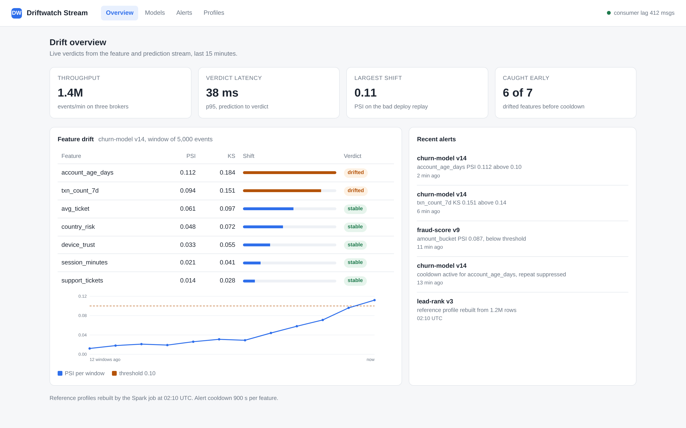
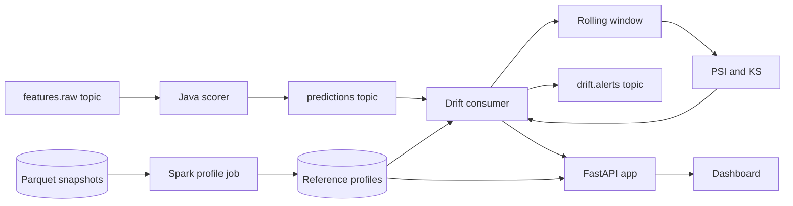

# Driftwatch Stream

Watches a live Kafka event stream for model and data drift and pages the team that owns the model.



## Why

A model is scored once against a training snapshot and then keeps running while the inputs around it move. The usual check is a notebook run on yesterday's export, so a bad deploy is found a day late, after the predictions have already gone out. Driftwatch Stream reads the prediction events as they arrive, keeps a reference profile per model version, and compares the live window against it feature by feature. It is for the people who own a model in production and need to know which input moved, not only that something did.

## How it works

The Java scorer reads raw feature events, scores them with a fixed linear model and publishes prediction events that carry the model name, version, prediction and the feature values. The Python consumer keeps a bounded rolling window per model, and once the window is full it compares each feature against the latest stored reference profile. A feature that crosses either threshold raises an alert on the alert topic, unless the same model and feature alerted inside the cooldown. The FastAPI app serves the stored profiles, the alert history and an on-demand evaluation of a JSON sample.



The Spark job is the other way into the reference store: it reads historical Parquet events, samples each feature and writes a sorted profile through the same store the consumer reads.

## Key decisions

- Drift is computed in the consumer process, not in a separate service, so a verdict needs no extra hop and no shared state beyond the profile files. The cost is that the window lives in one consumer's memory and is lost on restart.
- PSI bins come from the reference quantiles rather than fixed edges, which keeps the statistic meaningful for features with skewed ranges. The cost is that a reference profile with very few distinct values collapses to two bins.
- Alerts are keyed by model and feature with a cooldown, so a feature that stays shifted does not flood the topic. The cost is that a second, different shift on the same feature waits for the cooldown to pass.
- Reference profiles are plain JSON files on disk, which makes them easy to inspect and to write from Spark. The cost is that the store is local to the host and needs a shared volume when several replicas run.

## Tech stack

- Python 3.10 with FastAPI, uvicorn, confluent-kafka, numpy, pydantic and pyyaml
- Java 17 with kafka-clients, jackson-databind and slf4j-simple, built by Maven
- PySpark for the profile rebuild job
- Kafka for the feature, prediction and alert topics

## Quick start

Prerequisites: Python 3.10 or newer, JDK 17, Maven 3.9, and a Kafka broker reachable at the configured bootstrap address.

```bash
pip install -e ".[dev]"
driftwatch-api
driftwatch-consumer
mvn -f scorer/pom.xml package
java -jar scorer/target/scorer.jar
spark-submit spark/build_profiles.py --input s3://driftwatch/events/ --model churn-risk --version v7 --sample 20000 --out ./profiles
pytest
```

| Variable | What it sets | Default |
| --- | --- | --- |
| `DRIFTWATCH_CONFIG` | Path to the YAML config the API loads | `config/driftwatch.yaml` |
| `PORT` | Port the API listens on | `8080` |
| `KAFKA_BOOTSTRAP` | Broker address for the Java scorer | `localhost:9092` |
| `INPUT_TOPIC` | Topic the scorer reads raw features from | `features.raw` |
| `OUTPUT_TOPIC` | Topic the scorer writes predictions to | `predictions` |
| `GROUP_ID` | Consumer group of the Java scorer | `driftwatch-scorer` |

## Usage

Store a reference profile and read it back:

```bash
curl -s -X POST localhost:8080/api/models/churn-risk/reference \
  -H 'content-type: application/json' \
  -d '{"version":"v7","features":{"tenure_days":[12.0,40.0,180.0],"sessions_7d":[1.0,4.0,9.0]}}'
```

```json
{"model":"churn-risk","version":"v7","path":"profiles/churn-risk/v7.json"}
```

```bash
curl -s localhost:8080/api/models/churn-risk/status
```

```json
{"model":"churn-risk","version":"v7","features":["sessions_7d","tenure_days"],"psi_threshold":0.2,"ks_threshold":0.1,"window_size":5000}
```

## Project structure

```text
driftwatch/        consumer, drift math, profile store, window, FastAPI app
scorer/            Java scorer service and its Maven build
spark/             profile rebuild job
config/            driftwatch.yaml
tests/             drift math and consumer tests
ui/                static dashboard page
```

## Limitations

- The rolling window is in memory, so a consumer restart starts the comparison from an empty window.
- Only numeric features are compared; categorical features need to be encoded before they reach the stream.
- The reference store is a local directory, so several consumer replicas need a shared volume and do not share windows.
- The scorer uses one fixed linear model; swapping models means rebuilding the jar.

## License

MIT. The project builds on Apache Kafka, Apache Spark, FastAPI and PySpark, each under its own licence.
